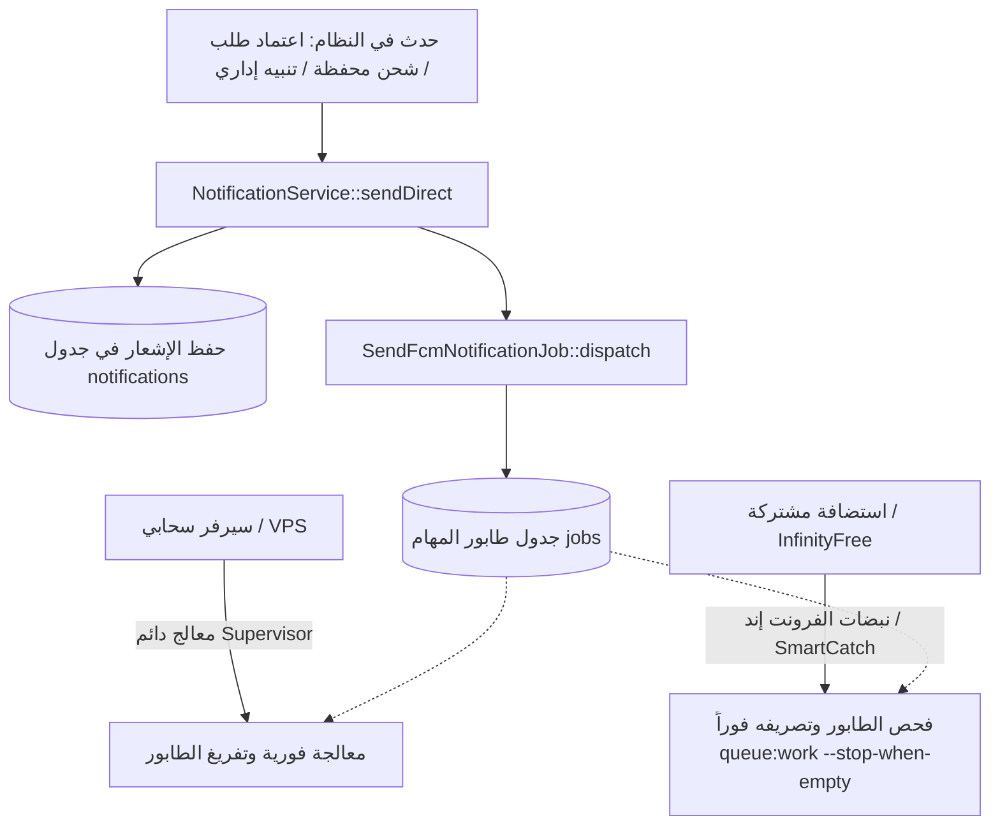

# الدليل الشامل لإعداد وربط نظام Firebase Cloud Messaging (FCM HTTP v1)
## لنظام نت سيلز (NetSales API)

---

### الفهرس
1. [المقدمة وبروتوكول FCM HTTP v1 الحديث](#1-المقدمة-وبروتوكول-fcm-http-v1-الحديث)
2. [خطوات إنشاء مشروع Firebase Console خطوة بخطوة](#2-خطوات-إنشاء-مشروع-firebase-console-خطوة-بخطوة)
3. [تفعيل خدمة FCM في Google Cloud Console](#3-تفعيل-خدمة-fcm-في-google-cloud-console)
4. [توليد وتحميل مفتاح الخدمة الخاص (Service Account JSON Key)](#4-توليد-وتحميل-مفتاح-الخدمة-الخاص-service-account-json-key)
5. [تهيئة إعدادات الخادم والباك إند (Laravel Configuration)](#5-تهيئة-إعدادات-الخادم-والباك-إند-laravel-configuration)
6. [ربط تطبيقات الموبايل والعميل (Flutter / Android / iOS)](#6-ربط-تطبيقات-الموبايل-والعميل-flutter--android--ios)
7. [معمارية الإرسال المتكيف المزدوج (Enterprise Dual-Mode Architecture)](#7-معمارية-الإرسال-المتكيف-المزدوج-enterprise-dual-mode-architecture)
8. [استكشاف الأخطاء وحلها (Troubleshooting & FAQs)](#8-استكشاف-الأخطاء-وحلها-troubleshooting--faqs)

---

### 1. المقدمة وبروتوكول FCM HTTP v1 الحديث

يعتمد نظام **NetSales** حصراً على واجهة **Firebase Cloud Messaging HTTP v1 API** السيادية الحديثة من Google.
- **لماذا HTTP v1؟**
  أوقفت شركة Google نهائياً بروتوكول الـ Legacy القديم المعتمد على مفتاح الخادم الثابت (`Server Key`). البروتوكول الجديد يعتمد على مصادقة متقدمة عبر توقيعات **OAuth 2.0 Bearer Tokens** المشتقة بأمان من شهادة حساب خدمة معتمد (Google Service Account).
- **المزايا الأمنية:**
  - الرموز مؤقتة وتتجدد تلقائياً كل 50 دقيقة في الكاش.
  - دعم كامل للتخصيص الدقيق لكل نظام (أندرويد، iOS، ويب).
  - حماية تامة من سرقة المفاتيح الثابتة.

---

### 2. خطوات إنشاء مشروع Firebase Console خطوة بخطوة

1. افتح متصفح الويب وتوجه إلى وحدة تحكم فايربيس الرسمية:
   [https://console.firebase.google.com](https://console.firebase.google.com)
2. سجّل الدخول بحساب Google المعتمد للمؤسسة أو المشروع.
3. اضغط على زر **"Add project"** أو **"إضافة مشروع"**.
4. **الخطوة 1 - اسم المشروع:**
   - اكتب اسم المشروع، مثلاً: `netsales-production` أو `netsales-app`.
   - سيظهر لك تلقائياً معرف المشروع الفريد عالمياً (Project ID)، مثل: `netsales-app-85f2a`.
   - **احفظ هذا المعرّف (Project ID)** لأننا سنضعه في ملف `.env`.
   - اضغط **Continue**.
5. **الخطوة 2 - إحصائيات جوجل (Google Analytics):**
   - يمكنك تفعيلها أو تعطيلها حسب رغبتك (يُفضل تفعيلها لمتابعة وصول الإشعارات).
   - اضغط **Continue** ثم اختر حساب Analytics واضغط **Create project**.
6. انتظر ثوانٍ حتى يتم تجهيز المشروع، ثم اضغط **Continue** للدخول للوحة التحكم الرئيسية للمشروع.

---

### 3. تفعيل خدمة FCM في Google Cloud Console

في المشاريع الجديدة، يجب التأكد من تفعيل واجهة البرمجة الرسمية:
1. توجه إلى [Google Cloud Console API Library](https://console.cloud.google.com/apis/library/fcm.googleapis.com).
2. تأكد من تحديد مشروعك من القائمة العلوية المنسدلة.
3. ابحث عن: **Firebase Cloud Messaging API**.
4. إذا كان الزر يظهر **"ENABLE"** أو **"تفعيل"**، اضغط عليه لتفعيل الواجهة.
5. تأكد من أن الحالة أصبحت **API Enabled**.

---

### 4. توليد وتحميل مفتاح الخدمة الخاص (Service Account JSON Key)

هذه الخطوة هي الأهم لربط الباك إند:
1. في لوحة تحكم [Firebase Console](https://console.firebase.google.com)، اضغط على أيقونة الترس ⚙️ بجانب **Project Overview** في القائمة الجانبية اليسرى.
2. اختر **Project settings** (إعدادات المشروع).
3. انتقل إلى التبويب: **Service accounts** (حسابات الخدمة).
4. ستجد أمامك كود برمجي بلغات مختلفة؛ تأكد من تحديد خيار **Firebase Admin SDK**.
5. اضغط على الزر الأزرق: **"Generate new private key"** (توليد مفتاح خاص جديد).
6. ستظهر لك نافذة تأكيد تحذيرية تفيد بأهمية سرية هذا الملف؛ اضغط على **"Generate key"**.
7. سيقوم المتصفح فوراً بتحميل ملف بصيغة `.json` باسم شبيه بـ:
   `netsales-app-85f2a-firebase-adminsdk-xxxxx.json`.
8. أعد تسمية الملف ليكون اسماً قياسياً موحداً:
   `firebase-service-account.json`.

---

### 5. تهيئة إعدادات الخادم والباك إند (Laravel Configuration)

#### أ. رفع وتأمين ملف الشهادة:
1. انقل الملف `firebase-service-account.json` إلى مجلد التخزين الآمن بالخادم:
   ```text
   d:\Smartix\NetSales\netsales_api\storage\app\firebase-service-account.json
   ```
   (على سيرفرات لينكس: `/var/www/netsales_api/storage/app/firebase-service-account.json`)
2. تأكد من إعطاء الملف أذونات قراءة آمنة وخاصة بسيرفر الويب:
   ```bash
   chmod 600 storage/app/firebase-service-account.json
   ```

#### ب. ضبط ملف البيئة `.env`:
افتح ملف `.env` في المسار الرئيسي للمشروع، وأضف أو عدّل المتغيرات التالية:
```env
# تفعيل إشعارات فايربيس السحابية
FIREBASE_ENABLED=true

# معرّف المشروع المستخرج من Firebase Console
FIREBASE_PROJECT_ID=netsales-app-85f2a

# مسار ملف شهادة حساب الخدمة (الافتراضي هو storage/app/firebase-service-account.json)
FIREBASE_CREDENTIALS_PATH=storage/app/firebase-service-account.json

# نمط تشغيل الطوابير (false للاستضافات المشتركة، true للسيرفرات ذات الـ Supervisor)
QUEUE_WORKER_ENABLED=false
```

---

### 6. ربط تطبيقات الموبايل والعميل (Flutter / Android / iOS)

لتبدأ أجهزة المستخدمين (نقاط البيع والمزودين) باستقبال الإشعارات:

#### أ. تسجيل التطبيقات داخل Firebase Console:
1. في **Project settings** -> تبويب **General**:
   - اضغط على أيقونة **Android** لإضافة تطبيق أندرويد:
     - أدخل الـ Package name (مثلاً: `com.smartix.netsales`).
     - حمل ملف `google-services.json` وضعه داخل مجلد `android/app/`.
   - اضغط على أيقونة **Apple (iOS)** لإضافة تطبيق آيفون:
     - أدخل الـ Bundle ID (مثلاً: `com.smartix.netsales`).
     - حمل ملف `GoogleService-Info.plist` وضعه داخل مسار المشروع في Xcode.
     - في تبويب **Cloud Messaging** في إعدادات فايربيس، ارفع مفتاح APNs Auth Key الخاص بحساب Apple Developer لتمكين الإرسال لـ iOS.

#### ب. استخراج رمز الـ FCM وإرساله لـ NetSales API:
داخل تطبيق العميل (Flutter / React Native / Kotlin / Swift):
1. عند تشغيل التطبيق وتسجيل الدخول، يستخرج التطبيق رمز الـ Token:
   ```dart
   String? fcmToken = await FirebaseMessaging.instance.getToken();
   ```
2. يرسل التطبيق طلباً برمجياً إلى NetSales API لحفظ وتحديث الرمز:
   - **الرابط:** `POST /api/v1/notifications/fcm-token`
   - **Headers:**
     ```http
     Authorization: Bearer {session_token}
     X-Session-Id: {session_id}
     Content-Type: application/json
     ```
   - **Body:**
     ```json
     {
       "device_uuid": "c3b9d628-98e3-4710-9b5d-8b0d4c62c2f1",
       "fcm_token": "fH9_...k0w:APA91bF... (رمز فايربيس الطويل)",
       "device_name": "Samsung Galaxy S24 Ultra",
       "device_type": "ANDROID"
     }
     ```
3. يقوم النظام آلياً بتخزين الرمز في جدول `user_devices` وتحديث تاريخ آخر استخدام وتنشيط الجهاز.

---

### 7. معمارية الإرسال المتكيف المزدوج (Enterprise Dual-Mode Architecture)

تم بناء نظام الإشعارات في NetSales بأسلوب هندسي متطور لا يعتمد على نوع الاستضافة:



#### مميزات هذا النمط:
1. **كود قياسي ونظيف 100%:** استخدام دالة `dispatch(...)` الأصلية للارافيل دون أي تعديل أو دوال التفافية مخصصة.
2. **مرونة كاملة:** يعمل تلقائياً وبنفس الكفاءة سواء على سيرفرات VPS مع Supervisor أو على استضافات مشتركة مثل InfinityFree.
3. **تصريف ذاتي عبر SmartCatch:** في الاستضافات التي لا تدعم الـ Cron الدائم، تستفيد معالجة الطوابير من نبضات تطبيق الفرونت إند الدورية لتصريف أي مهام معلقة في جدول `jobs` بأمان تام ودون تداخل (Anti-Overlapping).

---

### 8. استكشاف الأخطاء وحلها (Troubleshooting & FAQs)

#### س1: الإشعارات لا تصل لهواتف المستخدمين، كيف أتحقق؟
- تأكد من تفعيل `FIREBASE_ENABLED=true` في ملف `.env`.
- تأكد من وجود ملف `storage/app/firebase-service-account.json` وأن مساره صحيح وقابل للقراءة.
- افحص سجلات النظام عبر:
  ```bash
  tail -n 100 storage/logs/laravel.log
  ```
  ستجد سجلات واضحة من `FcmService` توضح عدد الأجهزة المرسل إليها أو سبب أي خطأ من خوادم Google.

#### س2: ماذا يحدث إذا قام المستخدم بحذف التطبيق أو تغيير الجهاز؟
- نظام NetSales يمتلك آلية تنظيف ذاتي (**Token Auto-Invalidation**): إذا أرجعت سيرفرات Google خطأ `UNREGISTERED` أو `NOT_FOUND`، يقوم النظام تلقائياً بتصفير `fcm_token = null` لهذا الجهاز في قاعدة البيانات لمنع إرسال طلبات فاشلة مستقبلاً وتوفير موارد السيرفر.

#### س3: كيف يمكن للإدارة إرسال إشعار يدوي للتجربة؟
يمكن للإدارة إرسال إشعار لحظي عبر واجهة الـ API أو Swagger:
- **المسار:** `POST /api/v1/admin/notifications/user`
- **Body:**
  ```json
  {
    "user_id": 1,
    "title": "إشعار تجريبي",
    "body": "هذا إشعار تجريبي لاختبار وصول رسائل Push FCM إلى الهاتف بنجاح.",
    "channels": ["in_app", "fcm"]
  }
  ```

---
**فريق التطوير المعماري — NetSales Cloud Engine**
