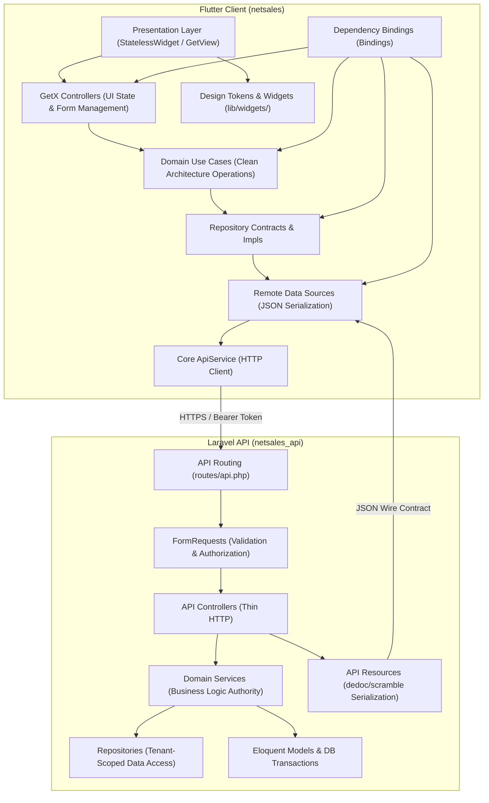

# NetSales — System Architecture & Layer Boundaries

## 1. Architectural Overview
NetSales decouples presentation and business logic across two isolated tiers:
- **Backend Tier (`netsales_api`):** Transactional business authority and persistence engine.
- **Client Tier (`netsales`):** Adaptive, reactive user interface for Network and POS actors.



---

## 2. Laravel Backend Architecture

### 2.1 Request Lifecycle Flow
1. **Routing:** Explicit versioned routes under `/api/v1/` grouped by domain and protected by `auth:sanctum` and tenant middleware.
2. **FormRequest:** Performs parameter validation and initial user authorization before entering the controller.
3. **Controller:** Extracts validated data and delegates execution to domain services. Controllers never contain raw SQL, accounting formulas, or direct financial mutations.
4. **Domain Services:** Execute business invariants inside atomic `DB::transaction(...)` blocks with `lockForUpdate()` where financial state is modified.
5. **API Resources:** Transform Eloquent models into strictly typed JSON responses with localized label fields (`*_label`).

---

## 3. Flutter Client Architecture

### 3.1 Feature Clean Architecture Structure & State Management
The Flutter application follows a strict 3-tier Clean Architecture structure within each feature:
```text
lib/features/<feature_name>/
├── data/
│   ├── datasources/     # Remote API datasources (JSON Serialization, ApiService)
│   ├── models/          # Data transfer models (fromJson/toJson mapping)
│   └── repositories/    # Repository implementations (implements domain contracts)
│
├── domain/
│   ├── entities/        # Pure immutable business entities (Pure Dart, zero framework imports)
│   ├── repositories/    # Abstract repository interfaces/contracts
│   └── usecases/        # Domain use cases orchestrating business actions
│
└── presentation/
    ├── screens/         # Responsive screen layouts (StatelessWidget / GetView exclusively)
    ├── widgets/         # Feature-specific atomic UI components (StatelessWidget exclusively)
    ├── controllers/     # GetxControllers (Reactive state, form controllers, use case delegation)
    └── bindings/        # GetX Bindings (Lazy dependency registration)
```

#### Permanent Architectural Invariants (Zero Exceptions)
1. **Zero `StatefulWidget` or `setState()` in Feature Presentation:** All screens, widgets, modal sheets, and dialogs must extend `StatelessWidget` or `GetView<T>`. All mutable states (text controllers, focus nodes, active filters, search queries, validation states) must reside in `GetxController` and be observed reactively via `Obx(...)`.
2. **Zero Direct HTTP Calls in Controllers:** `GetxController` classes must delegate exclusively to Domain Use Cases. Controllers are strictly forbidden from importing or calling `ApiService`, `package:http`, or `package:dio` directly.
3. **Pure Domain Layer:** The `domain/` directory must be 100% pure Dart. Zero imports from `data/`, `presentation/`, `GetX`, or `flutter/material.dart`.
4. **Mandatory Foundation Reuse:**
   - **Errors & Exceptions:** Always displayed using `CustomSnackbar.show(..., type: SnackType.error)`.
   - **Action Loading & Success:** Mutating actions must trigger `CustomAnimationOverlay.showLoading()` / `CustomAnimationOverlay.showSuccess()`, always wrapped in `finally { if (CustomAnimationOverlay.isShowing) await CustomAnimationOverlay.hide(); }`.
   - **Feed & Shimmer Loading:** Asynchronous loading states must display `CustomSkeletonFeed` or `CustomSkeletonShimmer`.
   - **Dialogs & Confirmations:** Unlinking, deleting, or critical actions must use `CustomDialog.danger` or `CustomDialog.confirmation`.
   - **Bottom Sheets:** Modal interactions must use `CustomBottomSheet.show(...)`.
5. **Component Placement & Screen Composition Separation:**
   - **`presentation/screens/`:** Responsible exclusively for page-level composition (arranging layout, coordinating feature widgets, connecting to GetX controller). Screen files must NOT contain large custom widget classes, complex list cards, or inline multi-section trees.
   - **`presentation/widgets/`:** Default location for feature-specific widgets tied to the feature's business domain (e.g. `network_pos_card.dart`, `network_pos_search_filter_header.dart`, `link_pos_bottom_sheet.dart`).
   - **`lib/widgets/`:** Exclusively for genuinely shared, business-agnostic components (no Network, POS, voucher, or domain entities).
   - **`lib/core/`:** Shared infrastructure, services, configuration, and utilities. Never presentation widgets.

### 3.2 Foundation & Shared Infrastructure Reuse
The application provides an extensive foundation in `lib/core/` and `lib/widgets/` that must be reused without duplication:

1. **Shared Widgets (`lib/widgets/`):**
   - **Badges & Chips (`lib/widgets/badges/`):** `CustomStatusBadge`, `CustomChip`.
   - **Dialogs (`lib/widgets/dialogs/`):** `CustomDialog`, `CustomAnimationOverlay`, `DialogActionBar`, `DialogBodyContent`, `DialogIconHeader`.
   - **Sheets (`lib/widgets/sheets/`):** `CustomBottomSheet`, `InvoicePrintFormatSheet`.
   - **Buttons (`lib/widgets/buttons/`):** `CustomButton`, `CustomThemeToggleButton`.
   - **Inputs (`lib/widgets/inputs/`):** `CustomTextField`, `CustomPasswordField`, `CustomPasswordRequirementItem`, `CustomPhoneField`, `CustomPinField`, `CustomDropdown`, `CustomNumericKeyboard`.
   - **Feedback & States (`lib/widgets/feedback/`):** `CustomEmptyState`, `CustomErrorState`, `CustomLoadingState`, `CustomLoadingIndicatorBar`, `CustomNotFound`, `CustomOfflineBanner`, `CustomUnauthorized`, `CustomTabPlaceholder`, Skeleton Shimmers (`CustomSkeletonCard`, `CustomSkeletonFeed`, `CustomSkeletonGrid`, `CustomSkeletonListTile`, `CustomSkeletonShimmer`, `CustomSkeletonText`).
   - **Toasts (`lib/widgets/toasts/`):** `CustomSnackbar`, `CustomToast`.
   - **Pickers (`lib/widgets/pickers/`):** `CustomDatePickerField`, `CustomDatePickerModal`, `CustomFilePicker`, `CustomImagePicker`, `CustomContactPickerIconButton`, `CustomColorPicker`, `CustomPosSelectorField`, `FileCardItem`, `FilePickerDropzone`.
   - **Foundation & Nav (`lib/widgets/foundation/` & `lib/widgets/navigations/`):** `CustomAppScaffold`, `CustomFloatingBottomNavBar`, `DoubleBackExitScope`.
   - **Media & QR (`lib/widgets/media_gallery/`, `images/`, `qr/`):** `MediaGalleryViewer`, `CustomCachedImage`, `CustomQrCode`.
   - **Dividers, Menus & Indicators (`lib/widgets/dividers/`, `menus/`, `indicators/`, `interactions/`):** `CustomLabeledDivider`, `CustomPopupMenu`, `CustomPageIndicator`, `CustomSegmentedBar`, `CustomInteractiveBounce`, `CustomeThemeSwitcher`.

2. **Core Utilities (`lib/core/utils/`):**
   - `DateFormatter`, `AmountFormatter`, `TextFormatter`, `FileSizeFormatter`, `FormValidators`, `IdempotencyHelper`, `SystemUiStyleResolver`, `ConnectionFailure`, `VoucherSheetCalculator`.

3. **Core Services (`lib/core/services/`):**
   - `ApiService`, `WorkspaceService`, `SessionService`, `ThemeService`, `StorageService`, `CredentialService`, `AppCryptoService`, `AppCacheService`, `InternetConnectionService`, `PermissionService`, `DeviceService`, `PushNotificationService`, `SmsRetrieverService`, `SoundService`, `ShareService`, `UrlLauncherService`, `FilePickerService`, `FileExportService`, `DatePickerService`, `ContactPickerService`, `QrCodeService`, `PublicSettingsService`, `AppExitService`.

4. **Design System Tokens (`lib/core/themes/` & `lib/core/constants/`):**
   - Colors: `AppColors.primary` (`0xFF0D7A5F`), `AppColors.secondary` (`0xFF1ABC9C`), `AppColors.tertiary` (`0xFF2ECC71`), and Material 3 surface containers.
   - Typography: `AppTypography` (`badgeText`, `bodyLarge`, `titleMedium`, etc.).
   - Radii & Spacing: `AppRadius.full`, `AppRadius.chip`, `AppRadius.card`, `AppSpacing`.
   - Elevation, Gradients & Motion: `AppElevation`, `AppGradients`, `AppMotion`, `AppThemes`.
   - Breakpoints: `AppBreakpoints` (`mobileSmallMax: 360`, `mobileMax: 600`, `tabletMax: 900`, `desktopMax: 1240`).

### 3.3 Permanent Premium UI/UX Engineering Standard
NetSales is an enterprise B2B sales management platform. Functional correctness alone is not sufficient for UI acceptance:
1. **Information Architecture First:** Establish hierarchy, workflow, and progressive disclosure before writing widget code.
2. **Anti-Repetition:** Do not build every screen using a generic template (title -> identical summary cards -> search field -> card list).
3. **No Over-Cardification:** Use cards only when physical boundaries genuinely aid comprehension; avoid nested container clutter.
4. **Data-Dense Clarity:** Highlight financial totals, make transaction signs clear, and prefer structured lists/tables over card clutter.
5. **Adaptive Multi-Form Factor:** Design explicitly for mobile (< 600dp, floating nav bar) and tablet (≥ 600dp, navigation rail and multi-column).
6. **First-Class Arabic & RTL:** Flawless reading order, correct icon direction, and complete state coverage (loading, empty, error, success).
7. **Visual Quality Gate:** Visual inspection across viewports and themes is mandatory prior to marking any UI feature complete.

---

## 4. Cross-Repository Authority Boundaries

| Responsibility | Sole Authority | Client Role |
|---|---|---|
| Pricing & Contract Discounts | Laravel (`PackageDiscountService`) | Presentation only |
| Request Modification Preview | Laravel (`RequestPricingReviewService`) | Submits request; displays non-binding preview |
| Sales Invoice Generation | Laravel (`SaleInvoiceService`) | Presentation & receipt printing |
| Wallet Debits & Credits | Laravel (`PosWalletLogRepository`) | Read-only ledger statement display |
| FIFO Repayment Allocation | Laravel (`DebtRepaymentService`) | Input amount; displays authoritative allocation |
| Debt Aging Buckets | Laravel (`PosDebtQueryService`) | Renders returned aging summary tiers |
| Enum Definitions & Translations | Laravel (`app/Enums/`) | Consumes wire strings, displays `*_label`, uses `EnumPresentationRegistry` |

---

## 5. Centralized Enum Contract & Semantic Badge System

### 5.1 Backend Enum Authority
1. **Backed Enums:** All business enums in Laravel are backed PHP enums residing under `app/Enums/`.
2. **Wire Casing:** Casing is strictly defined per enum (majority UPPERCASE, scheduled tasks lowercase/snake_case).
3. **Labels:** Each backed enum implements `label(): string` providing canonical Arabic translations.
4. **API Resources:** Must serialize both the wire value (`status`) and translated companion (`status_label`).

### 5.2 Flutter Client Consumption & Presentation
1. **Typed Parsing:** Dart enums provide `fromWire(String? raw)` with exact casing matches and `unknown` safe fallbacks.
2. **Domain Entities:** Expose typed getters (e.g. `NetworkStatus get typedStatus => NetworkStatus.fromWire(status);`) while keeping wire fields for serialization.
3. **Presentation Registry:** `EnumPresentationRegistry` centrally resolves `EnumPresentation` (label, icon, `SemanticTone`). Server-provided `*_label` takes precedence, falling back to local translations when null.
4. **Visual Components:**
   - `CustomStatusBadge`: Renders a semantic badge with dot/icon and theme-aware contrast.
   - `CustomChip`: Renders a compact or interactive semantic chip.
   - Ad-hoc color/status switches in presentation code are strictly prohibited.

