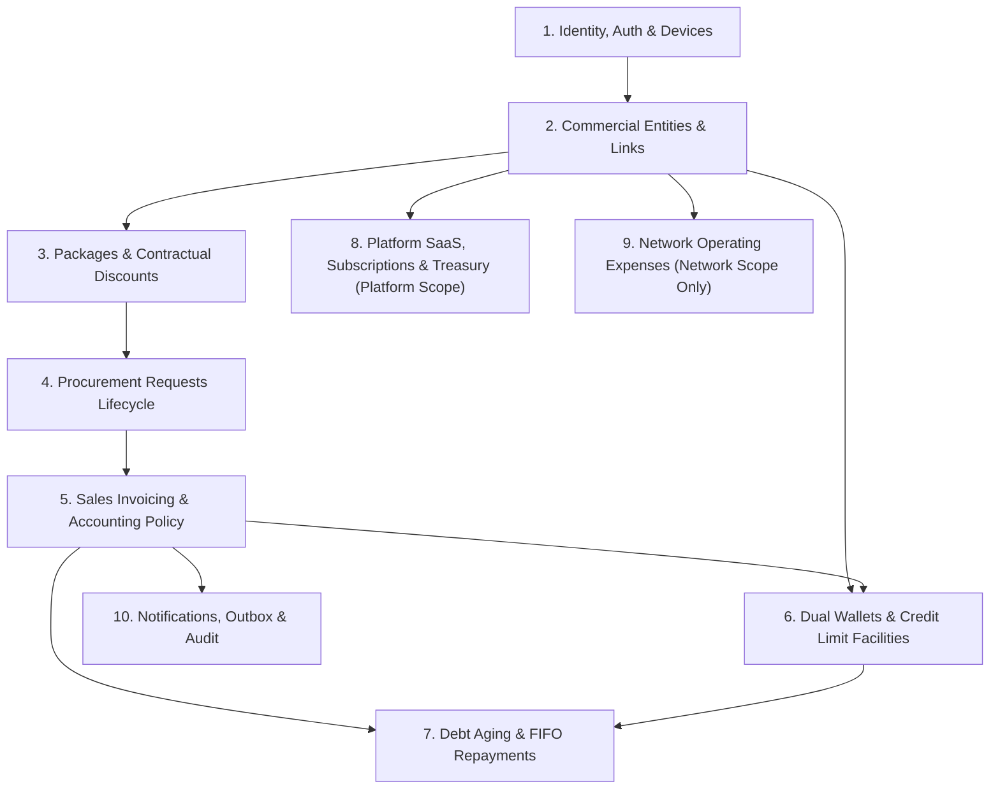

# NetSales — Business Domain Map

The NetSales system is partitioned into 10 cohesive business domains:

---

## Domain Analysis & Implementation Status

### Domain 1: Identity, Authentication & Device Governance
- **Status:** Backend Implemented (`VERIFIED`), Flutter Auth Baseline Implemented (`VERIFIED`).
- **Entities:** `User`, `Role`, `UserDevice`, `UserBan`, `OtpVerification`.
- **Services:** `AuthService`, `UserDeviceService`, `OtpService`.
- **Responsibilities:** Sanctum token management, multi-device registration, device blocking, OTP phone/email verification, biometrics/PIN login support.

### Domain 2: Commercial Entities & Merchant Links
- **Status:** Backend Implemented (`VERIFIED`), Flutter Directory Planned (`PROPOSED`).
- **Entities:** `Network`, `Pos`, `NetworkPos`, `NetworkUser`, `PosUser`.
- **Services:** `NetworkService`, `PosService`, `NetworkPosService`.
- **Responsibilities:** Merchant profile management, Network–POS partnership links, default discount terms, credit ceilings, status activation/banning.

### Domain 3: Packages & Contractual Discounts
- **Status:** Backend Implemented (`VERIFIED`), Flutter Catalog Planned (`PROPOSED`).
- **Entities:** `VoucherPackage`, `NetworkPosPackageDiscount`.
- **Services:** `VoucherPackageService`, `PackageDiscountService`.
- **Responsibilities:** Wholesale package definition (price, quota, validity), merchant-specific custom package tariffs, discount precedence rules.

### Domain 4: Procurement Requests Lifecycle
- **Status:** Backend Implemented (`VERIFIED`), Flutter Review Planned (`PROPOSED`).
- **Entities:** `Request`, `RequestItem`.
- **Services:** `RequestService`, `RequestPricingReviewService`.
- **Responsibilities:** Procurement request submission, pricing preview modification (`POST /requests/{id}/preview-modification`), quantity adjustments, cancellation, atomic approval/rejection.
- **States:** Strictly `PENDING`, `APPROVED`, `REJECTED`, `CANCELLED`.

### Domain 5: Sales Invoicing & Accounting Policies
- **Status:** Backend Implemented (`VERIFIED`), Flutter View Planned (`PROPOSED`).
- **Entities:** `SaleInvoice`, `SaleInvoiceItem`, `AccountEntry`.
- **Services:** `SaleInvoiceService`, `PosAccountingPolicyService`.
- **Responsibilities:** Atomic invoice creation upon request approval, cash vs. credit accounting, dual ledger entry generation, invoice printing and receipt generation.

### Domain 6: Dual Wallets & Credit Limit Facilities
- **Status:** Backend Implemented (`VERIFIED`), Flutter Wallet Planned (`PROPOSED`).
- **Entities:** `NetworkWallet`, `PosWallet`, `WalletLog`.
- **Repositories:** `PosWalletLogRepository`, `NetworkWalletLogRepository`.
- **Responsibilities:** Balance tracking, atomic deposit/withdrawal logs, credit limit enforcement, liquidity statements.

### Domain 7: Debt Aging & FIFO Repayments
- **Status:** Backend Implemented (`VERIFIED`), Flutter Debt Planned (`PROPOSED`).
- **Entities:** `PosRepayment`, `PosRepaymentAllocation`.
- **Services:** `DebtRepaymentService`, `PosDebtQueryService`.
- **Responsibilities:** Outstanding debt calculation, chronological aging tiers (Current, 1-30, 31-60, 61-90, 90+ days), atomic FIFO repayment settlement under row locks.

### Domain 8: Platform SaaS, Subscriptions & Treasury [PLATFORM SCOPE]
- **Status:** Backend Implemented (`VERIFIED`), Excluded from Mobile (`EXCLUDED`).
- **Entities:** `ProviderSubscription`, `SubscriptionPlan`, `SubscriptionPlanRequest`, `BankAccount`.
- **Services:** `ProviderSubscriptionService`, `SubscriptionRequestService`, `BankAccountService`.
- **Responsibilities:** Platform-owned SaaS plans and network subscription lifecycle, subscription-payment review and collection, and global Platform bank-account administration. Bank accounts are Platform treasury records, not tenant settlement accounts.

### Domain 9: Network Operating Expenses [NETWORK SCOPE ONLY]
- **Status:** Backend Implemented (`VERIFIED`), Flutter Network Expense Workflow In Progress (`IN_PROGRESS`).
- **Entities:** `Expense`, `ExpenseItem`, `ExpenseAttachment`.
- **Services:** `ExpenseService`.
- **Responsibilities:** Recording and reviewing daily operational expenses for a Network tenant, including itemized amounts and supporting attachments. Each expense belongs to a Network and is debited from that Network's wallet. POS expenses and Platform bank-account management are outside this domain.

### Domain 10: Notifications, Outbox & Audit
- **Status:** Backend Implemented (`VERIFIED`), Flutter Alerts Planned (`PROPOSED`).
- **Entities:** `Notification`, `SmsMessage`, `AuditLog`, `ScheduledTask`.
- **Services:** `NotificationService`, `SmsOutboxService`.
- **Responsibilities:** In-app notification center, SMS broadcast logging, automated system tasks (session pruning, OTP cleanup, scheduled reports).
