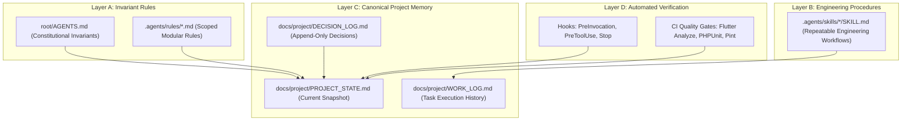

# NetSales — Persistent Agent Governance Architecture

## 1. Governance Architecture Overview

To ensure that engineering decisions, product rules, and approved requirements persist across sessions, model compactions, and development phases, NetSales uses a 4-layer persistent governance framework:

---

## 2. Layer Responsibilities

### Layer A: Constitutional & Scoped Invariants
- **`root/AGENTS.md`:** Universal constitutional rules automatically discovered by Antigravity in both repositories. Enforces product scope, financial authority, and approval boundaries.
- **`.agents/rules/*.md`:** Modular, focused rules loaded by trigger conditions (`always_on` or scoped triggers).

### Layer B: Engineering Procedures (Skills)
- Modular runbooks in `.agents/skills/<skill_name>/SKILL.md`.
- Encapsulate repeatable engineering workflows (session initialization, task handoffs, feature engineering).

### Layer C: Canonical Project Memory
- Authoritative documentation residing in `netsales_api/docs/project/`.
- Maintains current phase state (`PROJECT_STATE.md`), append-only decisions (`DECISION_LOG.md`), and execution history (`WORK_LOG.md`).

### Layer D: Automated Verification & CI
- Static analyzers (`flutter analyze`, `vendor/bin/pint`).
- Test runners (`flutter test`, `php artisan test`).
- Cross-repository contract verification script (`scripts/verify-project-governance.ps1`).

---

## 3. Cross-Repository Authority and Synchronization
- `smartixit/netsales_api` is the **canonical home** for all shared product, financial, domain, and API contract specifications.
- `smartixit/netsales` references canonical contracts via `netsales/docs/project/shared-contract-reference.md`.
- To avoid Windows symlink permission failures and Git sub-module complexity, synchronization is verified mechanically through `scripts/verify-project-governance.ps1`.

---

## 4. Context Restoration & Session Handoff Rules
1. **At Session Start:** Every session must execute the `netsales-session-protocol` skill before writing code.
2. **At Task Completion:** Every task must execute the `netsales-task-handoff` skill, updating `WORK_LOG.md` and `PROJECT_STATE.md`.
3. **No Unapproved Work:** Never proceed to the next milestone without explicit user approval recorded in `DECISION_LOG.md`.
