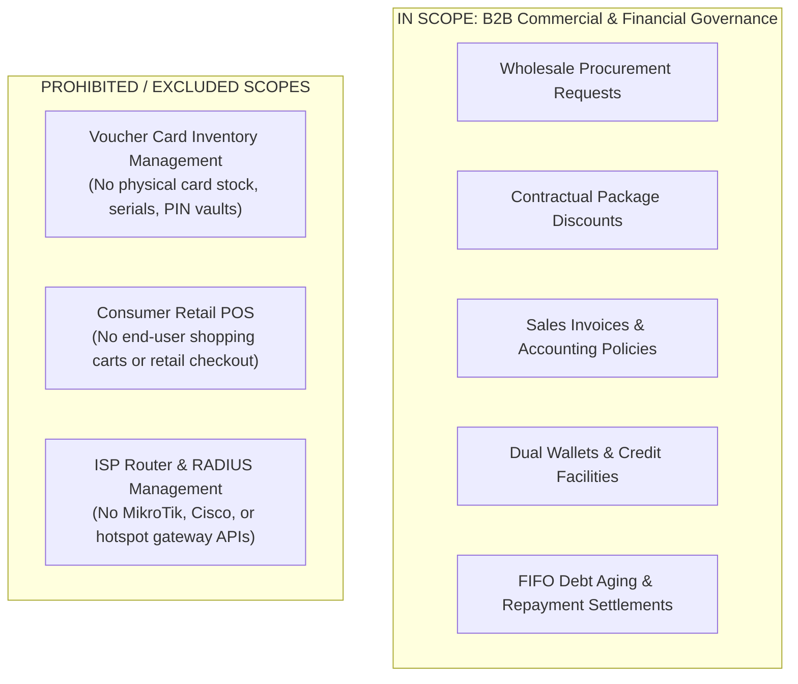

# NetSales — Product Scope & Non-Negotiable Boundaries

## 1. Core Mission and Target Domain
NetSales is designed exclusively for **B2B Wholesale Commercial Governance** between Internet Service Networks and authorized retail Points of Sale.

Its operational purpose is:
- Managing wholesale procurement contracts and custom discount matrices.
- Processing and approving wholesale package order requests.
- Generating authoritative sales invoices and accounting ledger entries.
- Tracking merchant credit facilities, aging debt balances, and repayments.
- Managing dual-wallet balances and operational liquidity.

---

## 2. Explicit Anti-Definitions [STRICT PROHIBITION]

To prevent architectural drift and scope contamination across future development phases, the following capabilities are **explicitly excluded** from the NetSales platform:



### 2.1 NOT a Voucher Card Inventory Management System
- NetSales does **not** track individual card serial numbers, scratch codes, PIN numbers, or card batch physical warehouse stock.
- The commercial unit is the **Voucher Package** (tariff, validity, wholesale quota), not physical voucher media.

### 2.2 NOT a Consumer Retail POS
- NetSales is **not** a checkout register for selling cards or data bundles to individual consumers or street pedestrians.
- The retail POS merchant uses NetSales upstream to order bulk quota and manage credit with the Network Provider.

### 2.3 NOT an ISP RADIUS Gateway
- NetSales does **not** configure router hardware, bandwidth limits, user PPPoE/Hotspot credentials, or RADIUS accounting pools.
- Technical provisioning of cards is handled externally by network operators' native systems.

---

## 3. Platform Scope vs. Mobile Operating Workspaces

```text
┌─────────────────────────────────────────────────────────────┐
│                 PLATFORM SCOPE (DESKTOP)                    │
│   • SUPER_ADMIN, SUPPORT_AGENT, ACCOUNTANT (Global)         │
│   • SaaS Subscriptions, Licensing, Master Treasury         │
│   • Reserved for future Windows Desktop Application         │
└─────────────────────────────────────────────────────────────┘
                               ▲
                       STRICTLY ISOLATED
                               ▼
┌──────────────────────────────┬──────────────────────────────┐
│   NETWORK WORKSPACE (MOBILE) │     POS WORKSPACE (MOBILE)   │
│   • NETWORK_OWNER            │   • POS_AGENT                │
│   • NETWORK_ACCOUNTANT       │   • POS_ACCOUNTANT           │
│   • NETWORK_USER             │   • POS_USER                 │
│   • Procurement Approvals    │   • Wholesale Ordering       │
│   • Custom Merchant Tariffs  │   • Credit Limit & Debt View │
│   • Receivables & Cash Flow  │   • Repayment Settlements    │
└──────────────────────────────┴──────────────────────────────┘
```

The Flutter application must never expose Platform Scope navigation or `SUPER_ADMIN` functionality.
