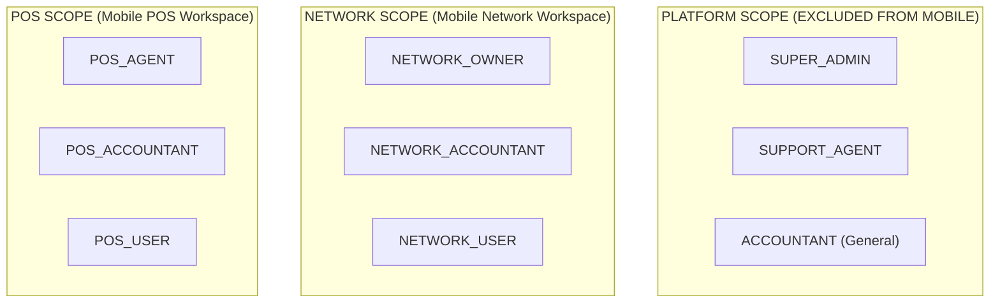

# NetSales — RBAC Architecture & Tenant Context Authorization

## 1. Role Catalog & Scope Matrix

The system implements 9 discrete roles partitioned into three scopes (`RoleScope::class`):

| Role Key | Scope | Mobile Workspace | Intended Business Responsibility |
|---|---|---|---|
| `SUPER_ADMIN` | `PLATFORM` | **EXCLUDED** | Global SaaS administrator, tenant provisioning. |
| `SUPPORT_AGENT` | `PLATFORM` | **EXCLUDED** | System ticketing and technical support. |
| `ACCOUNTANT` | `PLATFORM` | **EXCLUDED** | Global platform financial controller. |
| `NETWORK_OWNER` | `NETWORK` | Network Workspace | Master administrator of a specific Network tenant. |
| `NETWORK_ACCOUNTANT`| `NETWORK` | Network Workspace | Financial auditor for Network sales and receivables. |
| `NETWORK_USER` | `NETWORK` | Network Workspace | Operational staff for procurement review. |
| `POS_AGENT` | `POS` | POS Workspace | Master administrator of a specific retail POS store. |
| `POS_ACCOUNTANT` | `POS` | POS Workspace | Financial bookkeeper for store expenses and debts. |
| `POS_USER` | `POS` | POS Workspace | Retail store clerk submitting procurement requests. |

---

## 2. Authorization Boundaries & Tenant Context

### 2.1 Server-Side Sole Boundary
- The Laravel API backend is the **sole authorization boundary**.
- Flutter client checks (`isNetworkOwner`, `hasPermission`) are strictly UX conveniences to show/hide navigation options. They provide **zero security enforcement**.

### 2.2 Effective Tenant Permissions
- `$user->getAllPermissions()` retrieves global user permissions combined with primary role permissions.
- **Tenant Context Authority:** `User::hasPermission($key, $tenantId)` evaluates active memberships in `networkUsers` and `posUsers`.
- Users belonging to multiple Networks or POS stores must have each incoming API request authorized against the specific target tenant context.

---

## 3. Verified Seeder Discrepancies & Pending Decisions
1. **Missing Seeder Permissions for Scoped Accountants:** `RolePermissionSeeder.php` currently has **no assignment blocks** for `NETWORK_ACCOUNTANT` or `POS_ACCOUNTANT`. (Tracked under `DEC-02` as `PROPOSED`).
2. **Elevated Network User Rights:** Seed data currently grants `requests.approve` and `requests.reject` to `NETWORK_USER`.
3. **Identical Agent vs. User Permissions:** In default seeders, `POS_AGENT` and `POS_USER` receive identical permission arrays.
4. **Missing `role_scope` in API Output:** `AuthService::me()` returns `role_key` but omits `role_scope`. `RoleResource` returns `role_key` and `role_key_label` but omits `scope`. (Tracked under `DEC-01` as `PROPOSED`).
